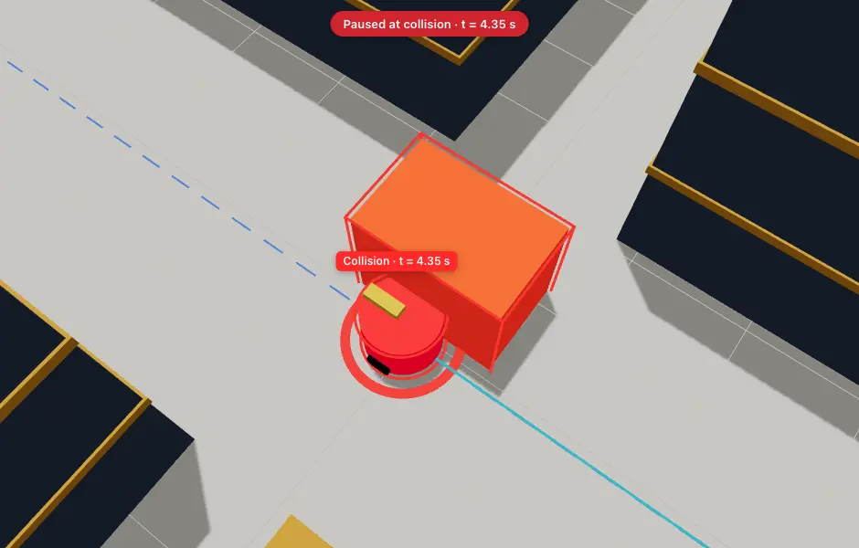

# WorldForge

WorldForge finds situations where a robot fails.

It simulates a robot driving through a warehouse. The robot plans a route around shelves and
tries to reach a goal while things like a forklift move around it. Each run ends in one of five
results: success, collision, timeout, no path, or stuck.

On top of the simulator, an AI model (NVIDIA Nemotron) looks at the failed runs, guesses why the
robot failed, and suggests new scenarios that might break it again. The simulator runs those
scenarios, and the results are compared against scenarios picked at random. Every run can be
replayed in 3D in the browser.



## How we used NVIDIA Nemotron and Nebius Token Factory

**Model:** `nvidia/Nemotron-3_5-Lightning`, called through
[Nebius Token Factory](https://tokenfactory.nebius.com)'s OpenAI-compatible chat completions API.

Nemotron does two jobs in the testing loop:

1. **Failure analysis.** It gets a short report of each run the simulator actually executed
   (changed parameters, outcome, metrics, collision position and time, sampled trajectory) and
   returns a failure hypothesis with evidence. Every piece of evidence must cite the runs it comes
   from (S1, S2, ...). A citation of a run that was never executed is rejected.
2. **Scenario generation.** It proposes new scenarios as parameter changes to the forklift-crossing
   layout (forklift speed, start time, direction, size, aisle widths, robot speed, and so on),
   each with a hypothesis and a predicted outcome. The Python simulator checks every value against
   fixed ranges before running anything. Nemotron never writes code and never reports results.

The loop runs like this: baseline run, then up to 3 rounds of analyse, propose 3 scenarios and
run them, with at most 10 Nemotron calls per experiment. The same number of random scenarios then
runs from the same parameter ranges, and the app shows how many failures each approach found.
In the UI, each prediction is shown next to the actual result and marked as held or wrong.

The code is in [`supabase/functions/_shared/`](supabase/functions/_shared/):
`nemotron.ts` (API client), `prompts.ts`, `validation.ts` and `workflow.ts`.

**How Token Factory helped:**

- We didn't host or deploy a model. One API key and an HTTPS endpoint gave us Nemotron, so the
  whole AI side runs from small Supabase Edge Functions.
- Because the API is OpenAI-compatible, the client is a plain `fetch` call with no SDK, and it
  runs unchanged in Deno, in tests and in the local dev server.
- JSON mode (`response_format: json_object`) gave us structured answers we can validate.
- The key stays server-side in Edge Function secrets. The browser never talks to Nebius.

Things we learned about the model: Nemotron 3.5 reasons for about 3,000 to 6,000 tokens before
answering, so each call takes 20 to 90 seconds. Strict `json_schema` mode sometimes returned empty
objects, so we use JSON mode with a template in the prompt, and a retry asks for plain text.

**Other Nebius services:** Token Factory is the only Nebius service we used. The rest runs on
Supabase (Edge Functions and Postgres), Fly.io (simulator worker) and Vercel (web app).

## How it fits together

- `src/worldforge/`: the Python simulator. It is the only thing that decides what happens in a run.
- `web/`: a Next.js app that replays runs in 3D and shows the AI results.
- `supabase/`: the backend. Edge Functions call Nemotron and the simulator, and Postgres stores
  experiments and results.
- `tests/`: Python tests.

## Requirements

- Python 3.11 or newer
- Node.js 20 or newer
- For the AI testing: [Deno 2](https://deno.com) and a Nebius Token Factory API key.
  Docker and the Supabase CLI are only needed for option B below.

## Run the simulator

```bash
python3 -m venv .venv
source .venv/bin/activate
pip install -r requirements.txt

python -m worldforge.demo --scenario success
python -m worldforge.demo --scenario failure
python -m worldforge.demo --scenario failure --headless
```

The `failure` scenario shows the main problem the project is about: the robot only checks
whether its next step is clear right now, so a forklift crossing the aisle drives into its side.

## Run the 3D viewer

```bash
python -m worldforge.export --out-dir web/public/replays
cd web
npm install
npm run dev
```

Open http://localhost:3000 and click "Live demo". The replays work without any backend.

## Run the AI testing locally

Start the simulator worker in one terminal, with the Python environment active:

```bash
WORKER_TOKEN=devtoken python -m worldforge.worker --port 8787
```

Then pick one of these.

**Option A: no Docker (quickest).** Runs all functions on one port with an in-memory store, so
experiments are lost when you stop it.

```bash
cd supabase/functions
NEBIUS_API_KEY=<your-key> SIMULATOR_TOKEN=devtoken deno task dev
```

If your Token Factory key is for a specific region, also set `NEBIUS_BASE_URL`. We used
`https://api.tokenfactory.eu-north1.nebius.com/v1`.

Create `web/.env.local` with:

```
NEXT_PUBLIC_SUPABASE_URL=http://127.0.0.1:54399
NEXT_PUBLIC_SUPABASE_ANON_KEY=local
```

**Option B: full local Supabase.** Needs Docker and the Supabase CLI. Experiments are saved in
Postgres.

```bash
supabase start
cp supabase/functions/.env.example supabase/functions/.env
supabase functions serve --env-file supabase/functions/.env
```

In `supabase/functions/.env`, set `NEBIUS_API_KEY` and `SIMULATOR_TOKEN=devtoken`. Copy
`web/.env.example` to `web/.env.local` and use the API URL and anon key from `supabase status`.

**Then, for either option:**

```bash
cd web && npm run dev
```

Open http://localhost:3000/demo?replay=failure, go to the "AI · Nemotron" tab, and click
"Run AI-guided tests". A full experiment takes a few minutes, because each Nemotron call takes
20 to 90 seconds.

The API key only lives on the server side. The browser never sees it.

## Tests

```bash
python -m pytest -q
cd supabase/functions && deno task test
cd web && npm run lint && npm run build
```

## License

[MIT](LICENSE)
